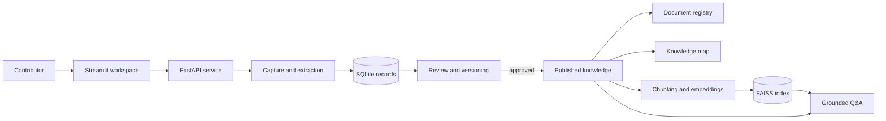

# Enterprise Knowledge Platform

An auditable, Persian-first workflow for capturing institutional knowledge, reviewing it, publishing approved records, and retrieving grounded answers from the resulting knowledge base.

This repository contains the v0.9 MVP: a FastAPI service, a Streamlit workspace, a SQLite persistence layer, document ingestion, a knowledge map, and retrieval-augmented question answering. It also includes a self-contained demonstration profile that runs entirely on synthetic data and does not require an API key or an external language model.

> **Project status:** active MVP. The demo is suitable for evaluation and portfolio use. The full application is intended for local development and controlled pilots; authentication, role-based authorization, and production storage controls must be added before organizational deployment.

## Why this project exists

Organizations lose valuable knowledge in handovers, project closures, incident reviews, policy changes, and routine operational work. Conventional document repositories preserve files but rarely preserve the context needed to reuse what those files contain: the problem, the method, the reasoning, the outcome, the owner, and the conditions under which the knowledge remains valid.

Enterprise Knowledge Platform treats knowledge capture as a governed lifecycle rather than a file-upload task:

1. A contributor describes an experience or uploads supporting material.
2. The platform extracts a structured draft and its provenance.
3. A reviewer corrects, rejects, or approves the record.
4. Approval creates an immutable published version and exposes it to discovery.
5. Search and grounded question answering operate only over approved knowledge.

The result is a small but complete reference implementation for provenance-aware enterprise knowledge management, with first-class support for Persian content.

## Run the demo

The demo is the fastest way to inspect the system. It contains five fictional records across IT, human resources, finance, operations, and project management. Four are published and one remains in the review queue so that both sides of the workflow are visible.

### Local launcher

Requirements: Python 3.11 or 3.12.

On Windows PowerShell:

```powershell
.\scripts\run-demo-local.ps1
```

On Linux or macOS:

```bash
chmod +x scripts/run-demo-local.sh
./scripts/run-demo-local.sh
```

The launcher creates an isolated `.demo` environment, installs only the lightweight demo dependencies, seeds synthetic records, and starts both services:

- Workspace: <http://localhost:8501>
- API documentation: <http://localhost:8000/docs>
- Health endpoint: <http://localhost:8000/health>

### Docker Compose

```bash
docker compose -f compose.demo.yml up --build
```

To stop the demo and remove its disposable data volume:

```bash
docker compose -f compose.demo.yml down -v
```

No API key, hosted model, or real organizational data is used in demo mode. Answers are generated by a deterministic local retrieval path and include links back to the synthetic source records. See [the demo guide](DEMO.md) for the five-minute walkthrough, example questions, reset instructions, and expected behavior.

## What you can explore

- **Flexible knowledge capture:** begin with free text, a document, or both; the system does not force every knowledge type into an incident-report template.
- **Document-assisted drafting:** extract usable content from PDF, image, text, Markdown, Word, and Excel files. OCR can be enabled for scanned Persian material.
- **Structured records:** retain the topic, method, context, steps, analysis, outcome, key points, references, ownership, access level, and source provenance.
- **Quality assessment:** calculate completeness and review signals before a draft enters the publication workflow.
- **Governed publication:** keep drafts out of retrieval until a reviewer approves them; corrections create a new version rather than silently replacing history.
- **Knowledge map:** browse approved records through relationships such as unit, subject, method, project, asset, and outcome.
- **Grounded retrieval:** retrieve relevant approved passages and produce answers with source attribution.
- **Persian PDF export:** create readable record exports with right-to-left content support.
- **Graceful degradation:** a failed embedding operation is recorded without preventing the approved record and its attachments from being published.

## Architecture



The API owns the workflow and persistence rules. The Streamlit application is a client of that API, not a second implementation of the business logic. SQLite stores records, review state, versions, documents, and graph relationships. The full profile uses multilingual sentence embeddings and FAISS for local semantic retrieval. The demo replaces that heavyweight retrieval path with deterministic token scoring while preserving the same product flow.

More detail is available in [Architecture](docs/ARCHITECTURE.md).

## Demo and full profiles

| Capability | Demo profile | Full development profile |
| --- | --- | --- |
| Dataset | Synthetic and automatically seeded | User-created records and documents |
| External API key | Not required | Optional AvalAI-compatible endpoint |
| Retrieval | Deterministic local token scoring | Multilingual embeddings with FAISS |
| Main dependency set | `requirements-demo.txt` | `requirements.txt` |
| Persistence | Disposable `.demo` workspace or Docker volume | Configurable local storage paths |
| Intended use | Evaluation, screenshots, portfolio review | Development and controlled pilots |

## Full development setup

### 1. Create an environment

```powershell
python -m venv .venv
.venv\Scripts\Activate.ps1
python -m pip install --upgrade pip
pip install -r requirements.txt
```

For Linux or macOS, activate the environment with `source .venv/bin/activate`.

### 2. Configure the application

```powershell
Copy-Item .env.example .env
```

The application can perform rule-based extraction without a language-model credential. Supplying an AvalAI-compatible API endpoint improves extraction of less regular documents.

| Variable | Purpose | Default |
| --- | --- | --- |
| `AVALAI_API_KEY` | Credential for optional model-assisted extraction | empty |
| `AVALAI_BASE_URL` | OpenAI-compatible API base URL | `https://api.avalai.ir/v1` |
| `AVALAI_MODEL` | Model used for assisted extraction | `gpt-4o-mini` |
| `EMBEDDING_MODEL` | Sentence Transformer used for semantic indexing | `paraphrase-multilingual-MiniLM-L12-v2` |
| `EMBEDDING_DEVICE` | Embedding execution device | `cpu` |
| `SQLITE_PATH` | SQLite database location | `storage/knowledge.db` |
| `UPLOADS_DIR` | Uploaded source files | `data/uploads` |
| `VECTOR_DIR` | FAISS index storage | `storage/vector_db` |

Keep `.env` local. It is excluded from version control.

Optional OCR requires Tesseract and the Persian language pack (`fas`). Missing OCR support does not prevent a file from being attached or submitted for review; it only limits text extraction from scanned pages and images.

### 3. Start the API and interface

Run these commands in separate terminals with the virtual environment active:

```powershell
python -m uvicorn app.main:app --reload --host 127.0.0.1 --port 8000
```

```powershell
streamlit run ui.py
```

Open <http://localhost:8501>. Interactive API documentation is served at <http://localhost:8000/docs>.

The full profile can also be started with:

```bash
docker compose up --build
```

## Repository layout

```text
.
├── app/                       API, workflow, ingestion, persistence, and demo seed
├── src/                       chunking, embeddings, retrieval, vector store, and LLM client
├── tests/                     API and domain regression tests
├── scripts/                   local and Docker demo launchers
├── storage/vector_db/         runtime vector-index location (contents ignored)
├── docs/
│   ├── ARCHITECTURE.md        component and data-flow decisions
│   ├── DEPLOYMENT.md          deployment notes and production checklist
│   └── RESEARCH_ARTICLE.md    doctoral-level research article based on the project
├── ui.py                      Streamlit workspace
├── compose.demo.yml           lightweight, reproducible showcase profile
├── docker-compose.yml         full development stack
├── Dockerfile                 shared application image
└── pyproject.toml             test, lint, and formatting configuration
```

Runtime databases, uploads, vector indexes, environment files, and demo state are deliberately excluded from Git.

## Verification

Install the development tools and run the test suite:

```powershell
pip install -r requirements-dev.txt
pytest -q
ruff check .
ruff format --check .
```

GitHub Actions applies the same checks to supported Python versions. A separate smoke workflow builds the demo image, starts the stack, verifies the API and Streamlit health endpoints, and checks that the synthetic dataset was seeded.

## Research article

The repository includes [*A Governance-Centred, Persian-First Architecture for Enterprise Knowledge Capture and Retrieval-Augmented Generation*](docs/RESEARCH_ARTICLE.md), an English research article that develops the design rationale behind the implementation. It covers lifecycle governance, provenance, review-gated retrieval, multilingual representation, failure isolation, evaluation design, limitations, and directions for further research.

The article is supplied as a Markdown manuscript for review and adaptation. It has not been peer reviewed and should not be represented as a published academic paper without an appropriate submission and review process.

## Production boundaries

The MVP intentionally keeps infrastructure small enough to run on a laptop. That makes the design inspectable, but it is not a production security model. Before deploying it with organizational data, add at least:

- identity integration and role-based access control;
- authorization filters at both retrieval and source-delivery time;
- PostgreSQL or another managed transactional database;
- encrypted object storage, malware scanning, retention rules, and backups;
- background queues for OCR, parsing, embedding, and re-indexing;
- audit-log protection, observability, rate limiting, and secret management;
- privacy classification, deletion procedures, and model-provider governance.

Do not place confidential or personal information in the public demo. Security assumptions and responsible disclosure guidance are documented in [SECURITY.md](SECURITY.md); the broader rollout checklist is in [Deployment](docs/DEPLOYMENT.md).

## Roadmap

- Enterprise identity and RBAC with document-level retrieval filters
- PostgreSQL and object-storage adapters
- Asynchronous ingestion and re-indexing workers
- Reviewer assignment, service-level tracking, and notification hooks
- Retrieval evaluation sets for Persian enterprise terminology
- Structured audit events and operational dashboards
- Export/import tooling for controlled organizational migration

## Contributing

Bug reports, focused improvements, and reproducible evaluation cases are welcome. Please read [CONTRIBUTING.md](CONTRIBUTING.md) before opening a pull request. Changes to workflow state, versioning, or retrieval visibility should include regression tests because these paths protect the platform's governance guarantees.

## License

No open-source license has been selected for this repository. Unless a license file is added, the source remains available for inspection but all rights are reserved by the copyright holder.
